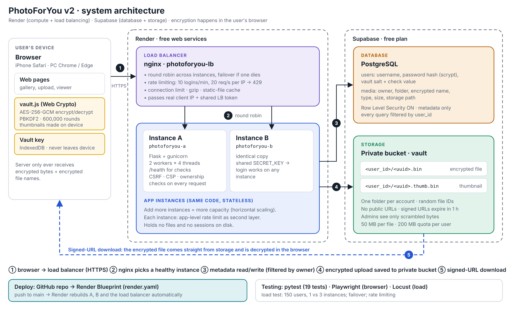

# PhotoForYou v2

A private cloud vault for photos and videos, built for iPhone users who keep
running out of iCloud storage. Upload from any browser, keep the full-quality
originals in the cloud, download them whenever you want.

CSEB5233 cloud project · Python Flask · Render · Supabase · nginx

## What v2 adds

| Area | What it does |
|---|---|
| **Traffic handling** | nginx load balancer in front of several identical app instances (round robin), automatic failover when an instance dies, health checks, rate limiting (HTTP 429), connection limits, gzip and static-file caching |
| **Scalability** | Stateless app (no files or sessions on the server), so you add capacity by adding instances. Measured: 3 instances = 2.1× throughput and 8× faster p95 than 1 instance |
| **Privacy** | End-to-end encryption in the browser (AES-256-GCM). The server, Supabase and the management team only store scrambled bytes |
| **Security** | Per-user storage folders, private bucket + expiring signed URLs, ownership check on every request, CSRF tokens, CSP and security headers, hashed passwords, input and file-type checks, storage quota |
| **Features** | Multi-file upload with progress, photos **and videos**, folders (merged case-insensitively), thumbnails, viewer, download original, rename, move, delete with confirmation, search, sort, storage usage bar, phone layout |
| **Testing** | 19 automated server tests, a browser end-to-end test, and Locust load tests with charts |

Full list of bugs found in v1 and how they were fixed: [`docs/CHANGES.md`](docs/CHANGES.md).

## Architecture



1. The browser encrypts each photo with the user's **vault key** (made from a vault passphrase that never leaves the device).
2. The **nginx load balancer** sends each request to a healthy app instance.
3. The **Flask app** checks the login and ownership, then saves the encrypted file to a **private Supabase Storage bucket** at `<user_id>/<random-id>.bin`, and its metadata to **Supabase Postgres**.
4. To view or download, the app gives the browser a **signed URL** that expires in 1 hour. The browser downloads the encrypted file straight from storage and decrypts it locally.

## Run it

### On your laptop, no Supabase needed (Windows, Mac or Linux)
```bash
pip install -r requirements.txt
python run_local.py            # open http://localhost:5000
```

### Local cluster: 3 instances + load balancer
With Docker Desktop:
```bash
docker compose up --build      # open http://localhost:8080
docker compose stop app-b      # simulate a crash; the site keeps working
```
On Linux, Mac or WSL with nginx installed: `./local/cluster.sh start 3`

### Tests
```bash
pip install -r requirements-dev.txt
pytest -v                                        # 19 server tests
python tests/e2e_proof.py --base http://localhost:8080 --samples <folder of photos>   # browser test
./loadtest/run_loadtests.sh scaling              # load tests (see docs/LOAD-TESTING.md)
```

### Deploy to Render + Supabase
Step by step: [`docs/DEPLOY.md`](docs/DEPLOY.md)

## Project structure
```
app.py                  Flask app: routes, security headers, rate limits
config.py               all settings from environment variables
backends/               data layer: supabase_backend.py (production), local_backend.py (laptop/tests)
templates/              HTML pages
static/js/vault.js      browser encryption (Web Crypto API)
static/js/upload.js     thumbnails + encrypt + upload with progress
static/js/gallery.js    decrypt thumbnails, folders, viewer, rename/move/delete
schema.sql              Supabase tables, RLS and private bucket
render.yaml             Render Blueprint: instance A, instance B, load balancer
lb/                     nginx load balancer for Render (Docker)
local/, docker/         nginx load balancer for the local cluster / docker compose
loadtest/               Locust load test, rate-limit test, chart script
tests/                  pytest tests, Playwright end-to-end proof, management-view proof
proof/                  screenshots, charts, logs, diagrams (see proof/INDEX.md)
```

## Known limits (for the Constraints slide)
- **Forgotten vault passphrase means the photos are gone for good.** Nobody, not even the team, can recover them. That is the point of end-to-end encryption.
- **Some details stay visible:** folder names, file sizes, types and dates are not encrypted.
- **HEIC and HEVC preview depends on the browser.** iPhone Safari can preview them, Chrome on Windows cannot. Download always returns the original.
- **Render free plan:** each service sleeps after 15 minutes idle (about 1 minute to wake), and only one instance is allowed per service, so scaling uses separate services behind our own nginx.
- **Supabase free plan:** 1 GB storage in total, 50 MB per file, and the project pauses after a week without activity.
- **Rate limits are kept per instance and per load balancer**, not in one shared store such as Redis.
